# Stock Dash — Dashboard Riset Saham US

Dashboard pribadi untuk memantau saham-saham US di watchlist: berita yang sudah dirangkum AI, kesehatan laporan keuangan, transaksi insider, kondisi sektor dan pasar global, plus alert ke Telegram.

## Tujuan Aplikasi

Investor ritel biasanya harus membuka banyak situs (berita, SEC EDGAR, laporan keuangan, data sektor) untuk memantau beberapa saham. Stock Dash mengumpulkan semuanya di satu tempat:

- **Hemat waktu**: berita disaring dan dirangkum AI (Gemini) dalam Bahasa Indonesia, lengkap dengan sentimen dan skor kepentingan.
- **Keputusan berbasis data**: laporan keuangan diolah jadi scorecard (profitabilitas, likuiditas, leverage, arus kas, valuasi, Piotroski F-Score).
- **Tidak ketinggalan info penting**: berita dengan skor kepentingan tinggi langsung dikirim ke Telegram.
- **Privat**: login hanya dengan akun Google yang emailnya terdaftar di allowlist.

## Fitur

| Fitur | Keterangan |
|---|---|
| 🔐 **Login Google** | Auth.js + Google OAuth, hanya email di tabel `allowed_emails` yang bisa masuk. |
| 📋 **Watchlist** | Tambah/hapus ticker, tandai status *holding* atau *watching*. |
| 📰 **Berita + Analisis AI** | Berita per saham dari Finnhub/Marketaux, dianalisis Gemini: ringkasan, kategori, sentimen (positif/netral/negatif), importance 1–5. |
| 📊 **Fundamentals Scorecard** | Data laporan keuangan dari FMP: revenue growth, margin, ROE/ROIC, current ratio, D/E, FCF, P/E, EV/EBITDA, Piotroski F-Score, plus flag peringatan dan ringkasan AI. |
| 🕵️ **Insider Trading** | Transaksi insider (Form 4) dari SEC EDGAR. |
| ⚖️ **Bandingkan Saham** | Tabel perbandingan metrik fundamental beberapa saham sekaligus. |
| 🏭 **Sektor US** | Performa harian ETF sektor (diverging bar) dan insight AI: sektor pemimpin, tertinggal, dan yang perlu dipantau. |
| 🌍 **Markets** | Berita ekonomi global, minyak, geopolitik, dan BTC. |
| 🔔 **Notifikasi Telegram** | Hubungkan akun Telegram dari halaman Pengaturan; terima alert berita penting watchlist, ringkasan pasar, dan ringkasan sektor. |

## Arsitektur & Flowchart

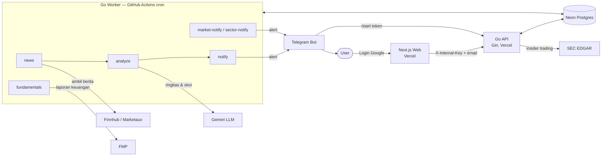

Alur singkat:

1. User login dengan Google → Next.js mengecek email ke Go API (`/v1/me`), ditolak jika tidak ada di allowlist.
2. User menambah ticker ke watchlist.
3. Worker terjadwal (GitHub Actions) mengambil berita → Gemini menganalisis → berita penting dikirim ke Telegram.
4. Setiap minggu worker memperbarui scorecard fundamental.
5. Dashboard membaca data dari Go API dan menampilkannya per halaman.

## Screenshot

### Login

Masuk dengan akun Google; email yang tidak terdaftar akan ditolak.

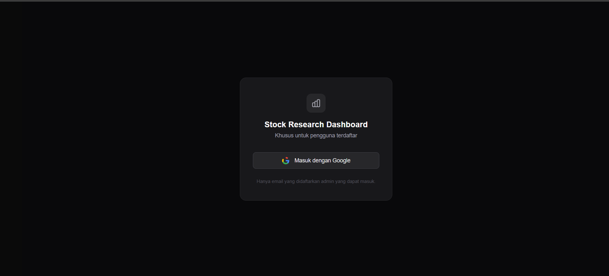

### Watchlist

Daftar saham yang dipantau, dengan status *holding* atau *watching*.

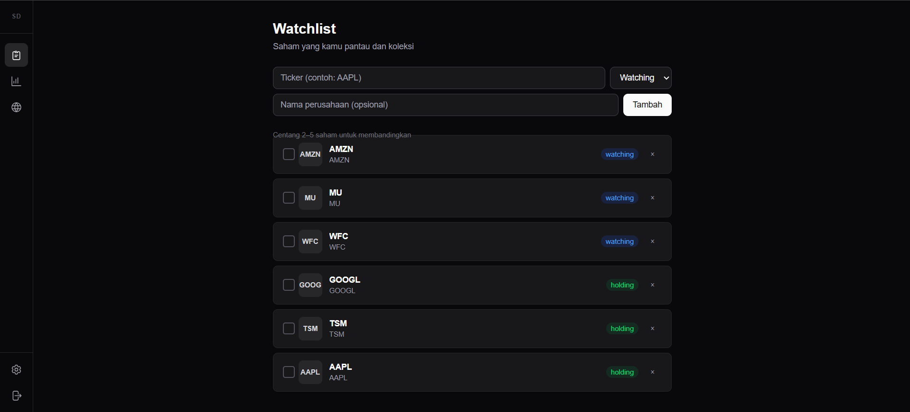

### Detail Saham

**Laporan keuangan**: scorecard profitabilitas, likuiditas, dan leverage, lengkap dengan Piotroski F-Score.

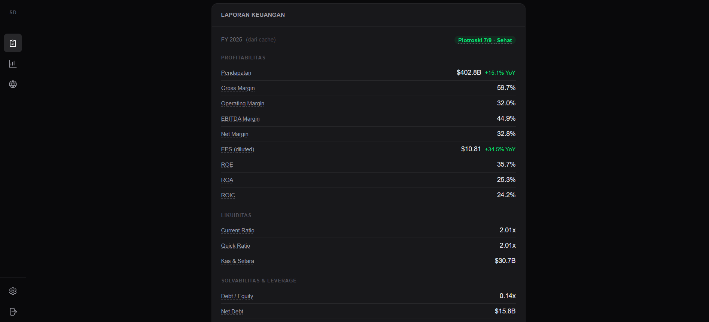

**Sinyal penting & AI Insight**: hal-hal yang perlu diperhatikan, outlook, kekuatan, dan risiko perusahaan.

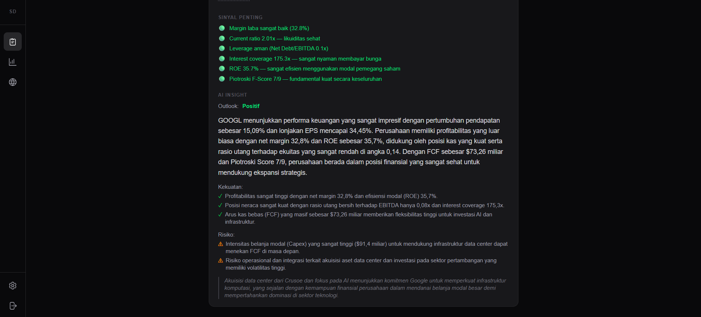

**Ringkasan berita AI**: rangkuman sentimen dari berita terbaru, plus daftar berita.

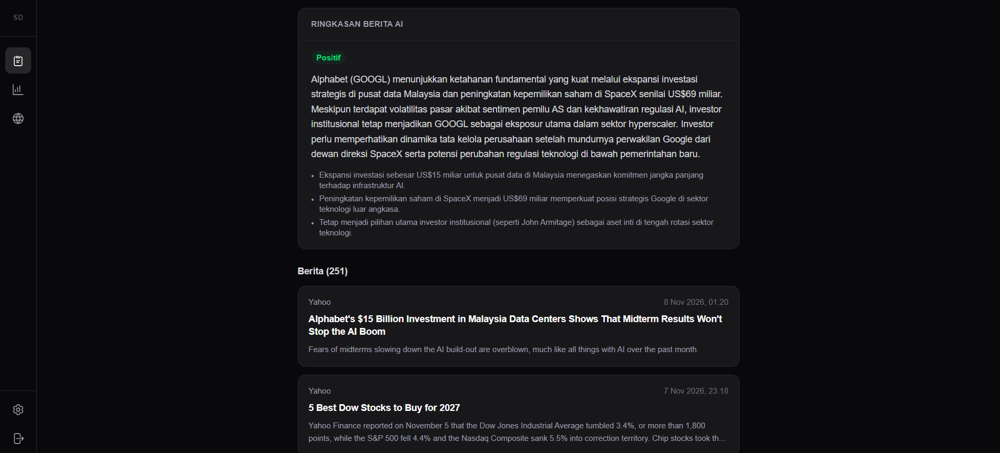

### Bandingkan Saham

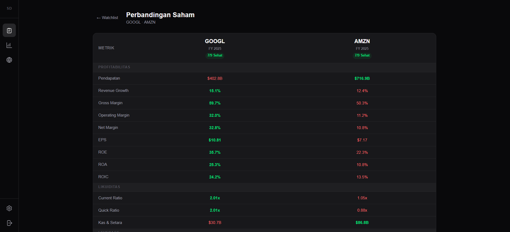

### Sektor US

Insight AI tentang sektor pemimpin, sektor yang tertinggal, dan sektor yang perlu dipantau:

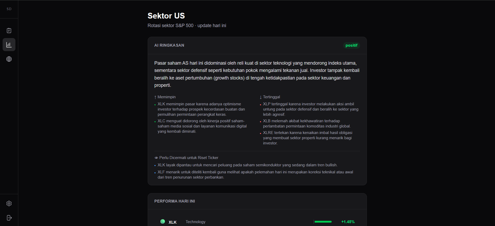

Performa harian ETF sektor:

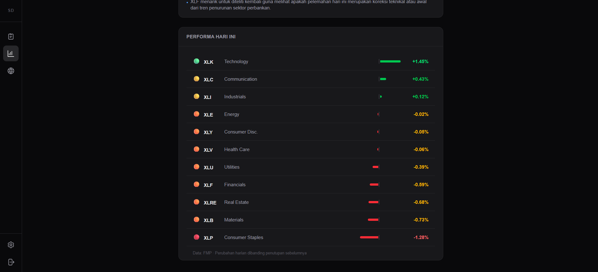

### Markets

Berita ekonomi global, minyak, geopolitik, dan BTC.

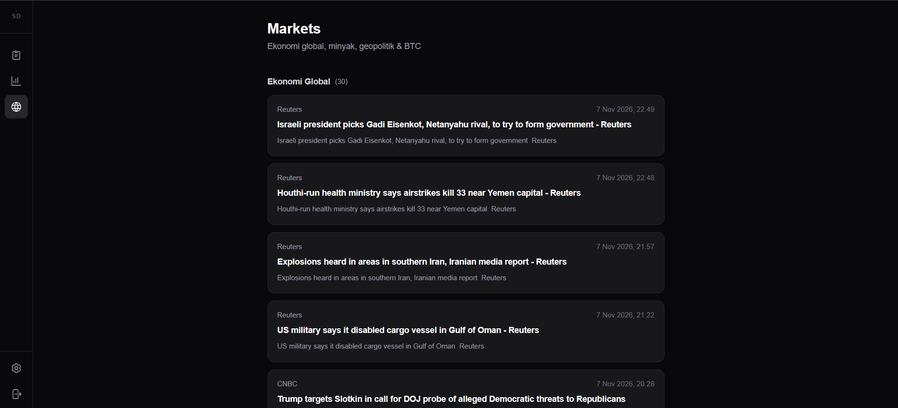

### Notifikasi Telegram

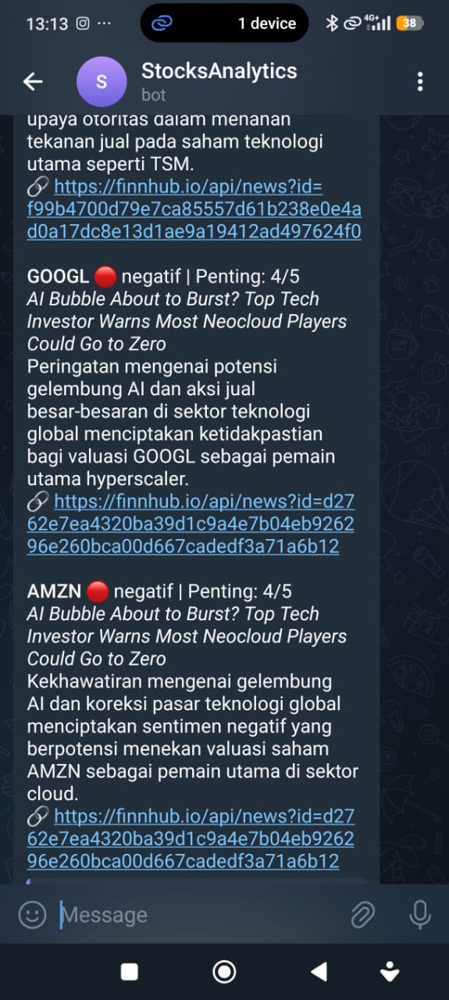

## Tech Stack

- **Frontend**: Next.js (App Router), TypeScript, Tailwind CSS, Auth.js
- **Backend**: Go, Gin, pgx
- **Database**: Neon Postgres (migrasi dengan goose)
- **AI**: Google Gemini
- **Data**: Finnhub, Marketaux, Financial Modeling Prep, SEC EDGAR
- **Infra**: Vercel (web + API), GitHub Actions (worker cron), Telegram Bot API

## Struktur Folder

```
api/
  cmd/api/        # HTTP API server
  cmd/worker/     # job terjadwal: news, analyze, notify, fundamentals, ...
  internal/       # edgar, fmp, llm, news, notify, scorecard, store, telegram
  migrations/     # skema database (goose)
web/
  app/            # halaman: watchlist, sectors, markets, settings, login
  components/     # UI components
.github/workflows # cron worker
vercel.json       # konfigurasi monorepo Vercel (web + api)
```

## Menjalankan Secara Lokal

```bash
# 1. API
cd api
cp .env.example .env          # isi DATABASE_URL, API key, dll.
go run ./cmd/api

# 2. Web (terminal lain)
cd web
cp .env.example .env.local    # isi AUTH_*, API_BASE_URL, INTERNAL_API_KEY
npm install
npm run dev                   # http://localhost:3000

# 3. Worker (opsional, jalankan manual)
cd api
go run ./cmd/worker -jobs=news,analyze,notify
```

`INTERNAL_API_KEY` harus sama di `api/.env` dan `web/.env.local`. Tambahkan email kamu ke tabel `allowed_emails` sebelum login.
